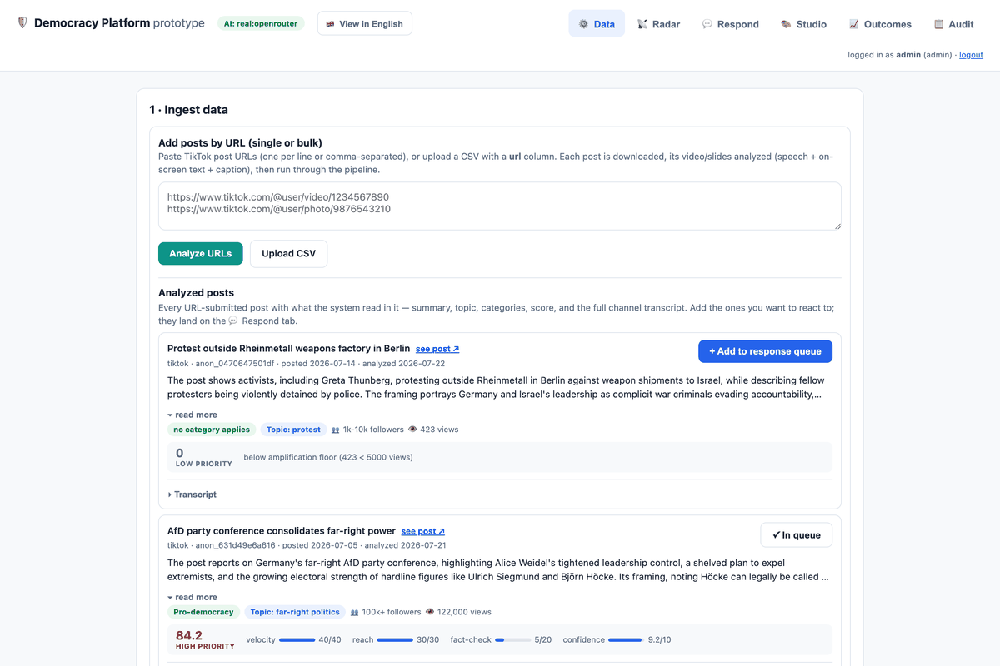
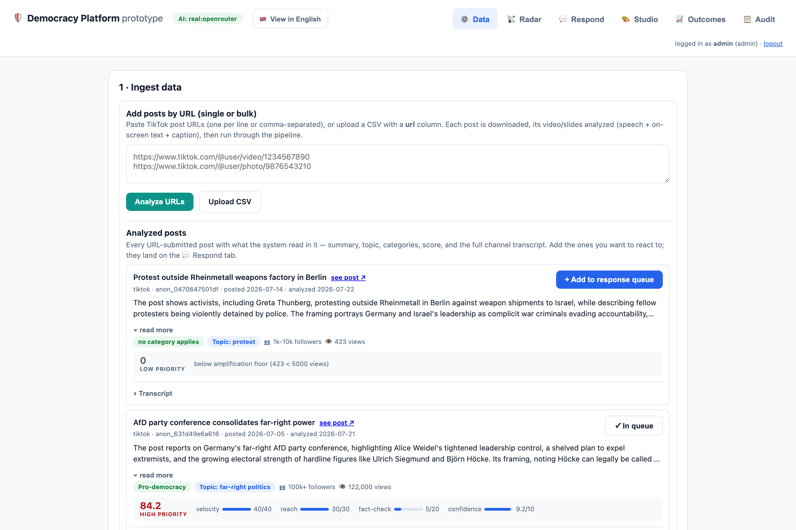
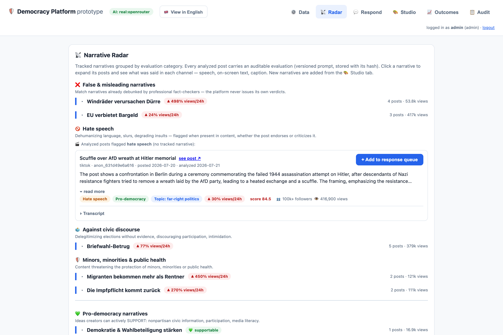
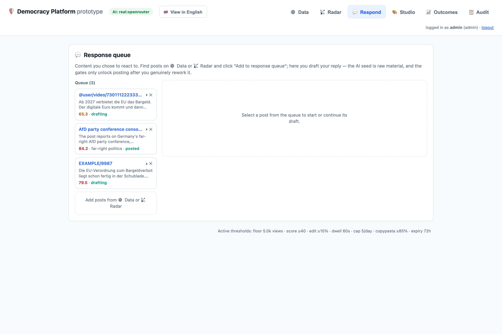
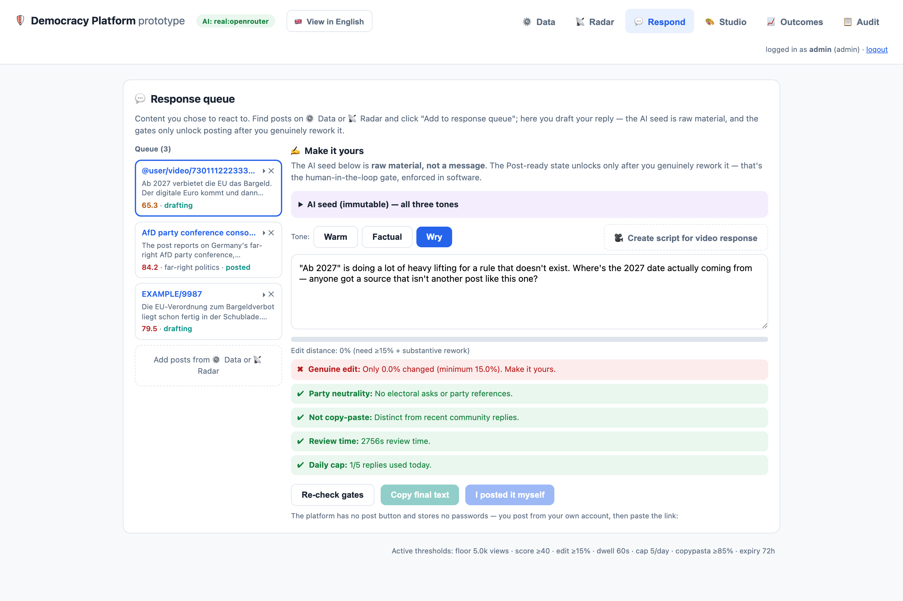
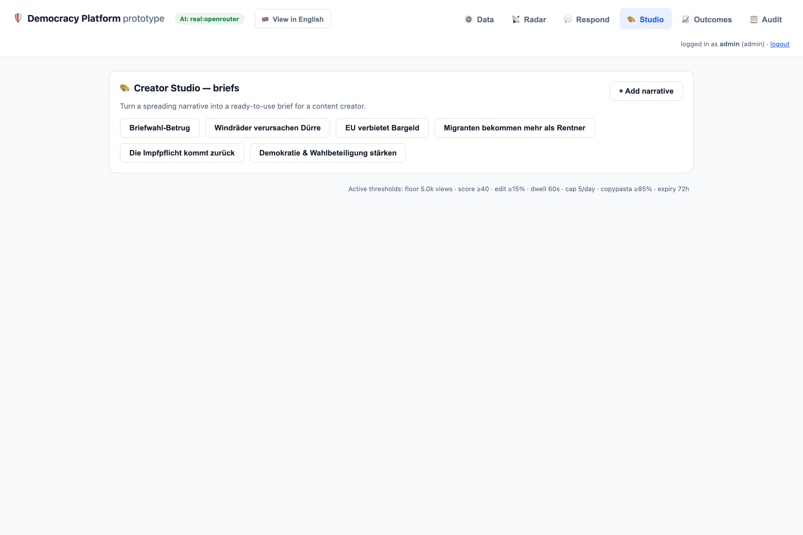
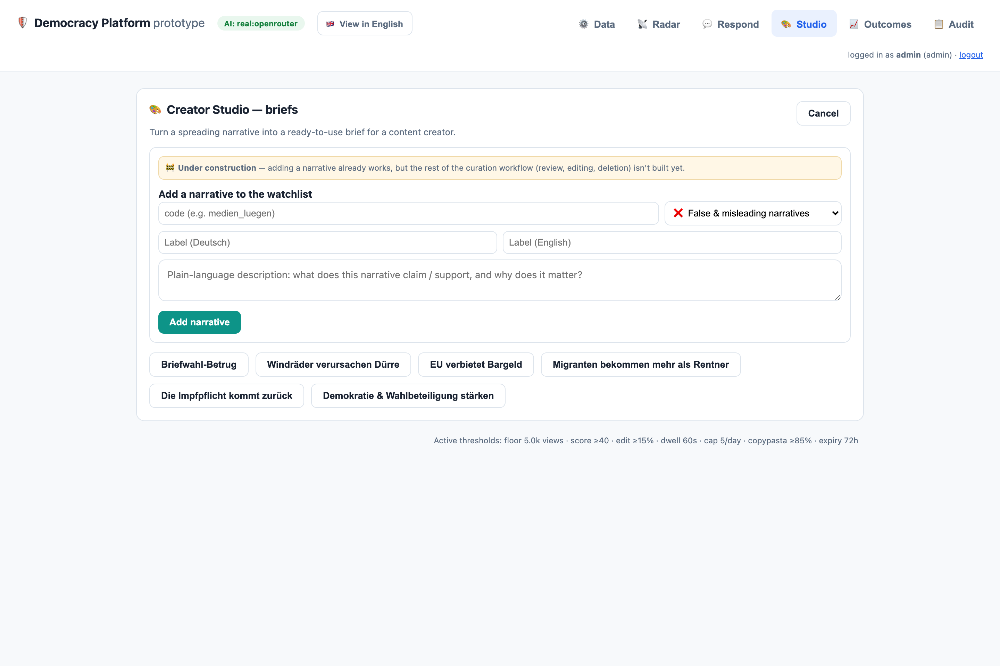
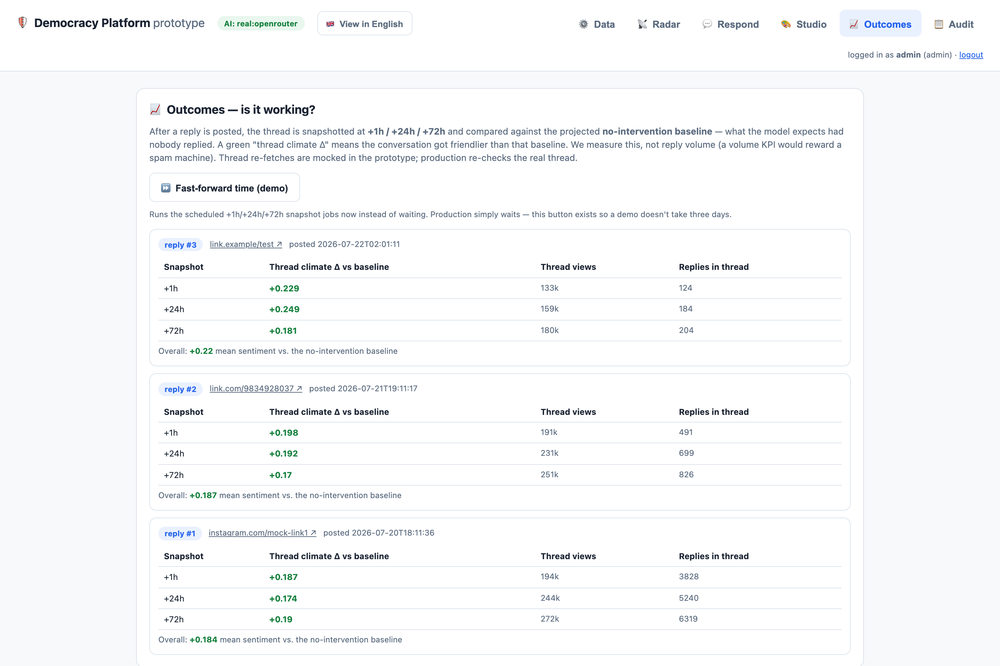
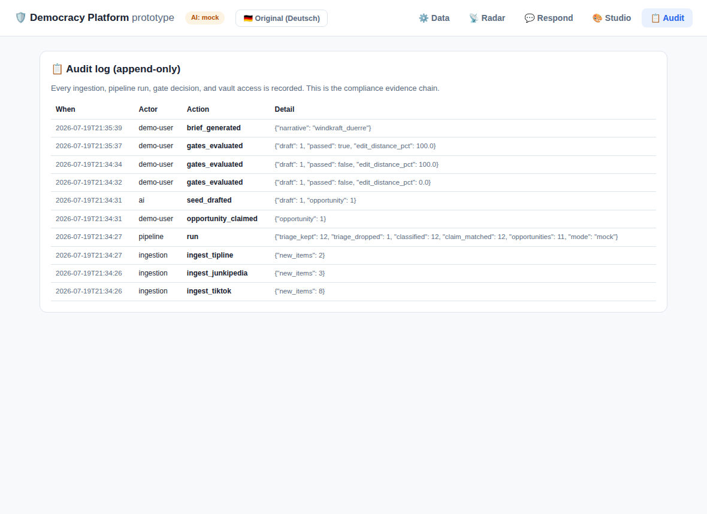

# Democracy Platform — Prototype

A working, self-contained prototype of the counter-disinformation platform from the
engineering plan: **social listening → AI enrichment → human-in-the-loop response**,
in a small FastAPI + Nuxt codebase.

Everything runs offline with zero accounts by default. Real platform integrations are
mocked with realistic fixture data; every mock has a step-by-step guide to make it real
(see below). With API keys in `.env`, the same code runs against real models, real
TikTok post acquisition, and a real Postgres (Supabase) database.

## Demo
[Watch the demo](./Demo-democracy-prototype.mp4)

## Quickstart

```bash
pip install -r requirements.txt
python run.py
# open http://localhost:8400
```

Log in with one of the three demo users — **admin**, **staff**, or **responder**
(one click, no passwords: it's a dev auth stub, swapped for Supabase Auth in
production — see `docs/integrations/supabase.md`). Responders only get the
Respond flow, scoped to their own drafts; admin/staff see everything.

Optional: `cp .env.example .env` and add an `ANTHROPIC_API_KEY`, `OPENAI_API_KEY`,
or `OPENROUTER_API_KEY` to switch every AI step from mock to a real model — the
reply drafts run on the strongest tier, mechanical stages on a cheap one. Add an
`APIFY_TOKEN` for real TikTok URL ingestion and `DB_BACKEND=postgres` +
`DATABASE_URL` for Supabase. Nothing else changes.

Run the tests: `python -m pytest tests/ -q` (~190 tests: gates, pipeline, media
ingestion, pseudonymization canary).

## Frontend

The primary UI is a Nuxt 3 + TypeScript SPA in `frontend-nuxt/`:

```bash
cd frontend-nuxt
npm install
npm run generate     # static build → frontend-nuxt/.output/public
cd .. && python run.py   # FastAPI now serves the built SPA at /
```

For development with hot reload, keep the backend running and start the dev server:

```bash
cd frontend-nuxt && npm run dev
# proxies /api and /static to http://localhost:8400 by default;
# point it elsewhere with: NUXT_API_PROXY=http://localhost:8410 npm run dev
```

The original zero-build page (`frontend/index.html`, vendored Vue) stays available
at **/demo** as a fallback, and needs no node toolchain at all — with no Nuxt build
present, `/` serves it too, so the repo keeps working without node.

## The 3-minute demo script

1. **⚙️ Data tab** — paste a TikTok post URL (or a CSV of them) and click **Analyze
   URLs**. A per-URL progress bar fills as the post is downloaded and its video
   analyzed — speech, on-screen text, and caption become one transcript. The analyzed
   card shows the summary, topic, evaluation categories, and transparent score (a
   low-reach post correctly scores 0 — amplification floor).
2. **📡 Radar** — tracked narratives grouped by evaluation category (false info, hate
   speech, civic discourse, … plus supportable pro-democracy narratives), ranked by
   24h growth. Every analyzed post carries an auditable evaluation, stored with the
   versioned prompt's hash. Toggle **View in English**.
3. **💬 Respond** — add a post to your response queue, open its draft: the AI seed
   comes in three tones (**Warm / Factual / Wry** — switch with one click). Try
   posting a variant unchanged: blocked — picking a tone counts as 0% edited.
   Rewrite it in your own words: the edit gate passes, the 60-second review timer
   still holds, then everything goes green. There is no "post" button — you copy the
   text, post it from your own account, and paste the link back.
4. **💬 Respond** — type "wählt nicht diese Partei" into a draft: the neutrality gate
   blocks it (German charity law: counter narratives, never campaign).
5. **🎨 Studio** — click a narrative: a creator brief with facts (from published
   fact-checks only), angles, and what to avoid. New narratives join the watchlist here.
6. **📈 Outcomes** — after a reply is marked posted, the thread is re-checked at
   +1h/+24h/+72h and compared against a no-intervention baseline.
7. **📋 Audit** — every ingestion, gate decision, and vault access, append-only.

## Screenshots

All eight screens, auto-cycling (READMEs can't run a real carousel, so this is an
animated slideshow — open the stills below for a closer look):



<details>
<summary><b>Individual screenshots</b> (click to expand)</summary>

**Data** — URL ingestion with per-URL progress, analyzed post cards


**Radar** — narratives by evaluation category, 24h growth


**Respond** — the response queue


**Respond** — tone picker + the five hard gates


**Studio** — creator briefs from published fact-checks


**Studio** — watchlist curation


**Outcomes** — thread climate vs. baseline


**Audit** — append-only evidence chain


</details>

## Integration status

| Integration | Status | Guide |
|---|---|---|
| TikTok post-URL ingestion (Apify, prototype-only) | 🟢 working | [docs/integrations/apify.md](docs/integrations/apify.md) |
| Media content extraction (video → speech/on-screen/caption) | 🟢 working (mock default) | [docs/integrations/media-extraction.md](docs/integrations/media-extraction.md) |
| Real AI models (Anthropic / OpenAI / OpenRouter) | 🟢 working (mock default) | [docs/integrations/llm.md](docs/integrations/llm.md) |
| Supabase / Postgres (production DB) | 🟢 working (SQLite default) | [docs/integrations/supabase.md](docs/integrations/supabase.md) |
| TikTok Research API | 🟡 mocked | [docs/integrations/tiktok.md](docs/integrations/tiktok.md) |
| Junkipedia | 🟡 mocked | [docs/integrations/junkipedia.md](docs/integrations/junkipedia.md) |
| Community tipline | 🟢 working (API; form hidden from UI) | built-in |
| Fact-check corpus (Google API / GADMO) | 🟡 mocked | [docs/integrations/factcheck.md](docs/integrations/factcheck.md) |
| X via DSA Article 40 | 🔴 pending application | [docs/integrations/x-dsa.md](docs/integrations/x-dsa.md) |
| Instagram (Meta Content Library) | 🔴 signals-only by contract | [docs/integrations/meta-content-library.md](docs/integrations/meta-content-library.md) |

## What this prototype proves (and what it fakes)

**Real:** the shared data spine (one pipeline feeding three products), pseudonymization
at the ingestion boundary (keyed HMAC + audited vault, canary-tested), all five hard
gates (genuine-edit, neutrality, copypasta, review time, rate cap), transparent scoring
with the amplification floor, the no-auto-post architecture, the append-only audit log,
EN/DE translation layer.

**Real (since M3.3):** the job queue — ingestion enqueues one job per item into a
`jobs` table; a background worker drains it (`FOR UPDATE SKIP LOCKED` on Postgres)
with retry/backoff and a dead-letter view in the UI. The "Run pipeline" button
remains as a synchronous drain of the same queue.

**Real (since M4.2):** outcome measurement — after a reply is marked posted, snapshot
jobs re-check the thread at +1h/+24h/+72h and compute the thread-climate delta against
a projected no-intervention baseline (plan Ch. 9); the 📈 Outcomes tab shows it, with a
fast-forward button so demos don't wait three days.

**Real (since M5):** media ingestion — a TikTok post URL is downloaded (Apify,
prototype-only scraping exception), its video/slides analyzed into one labeled
transcript (speech + on-screen text + caption, author handle scrubbed at the
boundary), evaluated against the narrative watchlist with a versioned prompt whose
hash is stored with every verdict, and scored — with a per-URL progress bar while
it runs. The Respond flow drafts reply seeds in three tones (Warm/Factual/Wry) on
the strongest model tier; picking a tone counts as 0% edited, so the genuine-edit
gate still demands real human rework.

**Faked, honestly:** bulk platform data (fixtures), thread re-fetches for outcome
snapshots (deterministic mock of the same shape), auth (local session stub with
three demo roles — production uses Supabase Auth).
Each fake is the simplest stand-in with the same interface as the real thing.

## Repo map

```
run.py               one-command launcher
app/
  main.py            FastAPI endpoints
  db.py              backend-switchable DB layer (SQLite default, Postgres/Supabase)
  pipeline.py        the 6 enrichment stages
  queue.py           job queue (SKIP LOCKED claim, backoff, dead-letter, progress stage)
  worker.py          background worker thread + periodic ingest scheduler
  gates.py           the hard gates (edit, neutrality, copypasta, dwell, rate)
  llm.py             AI layer — mock by default, real with a key; tiered models
  pseudo.py          HMAC pseudonymization + audited re-id vault
  connectors.py      data sources (mocked, with integration pointers)
  extract.py         media extraction: video/slides/audio → one labeled transcript
  media_ingest.py    URL ingestion: adapter registry, scrubbing, persistence
  apify_tiktok.py    TikTok post acquisition via Apify (prototype-only)
  prompts/           versioned prompt files (verdicts store the prompt's sha256)
frontend-nuxt/       primary UI — Nuxt 3 + TypeScript SPA (npm run generate)
frontend/index.html  zero-build fallback page (vendored Vue), served at /demo
mock_data/           realistic fixtures in real-API shapes
migrations/          Postgres schema (SQLite schema lives in app/db.py)
docs/integrations/   step-by-step guide per integration
docs/screenshots/    the images in this README
tests/               gates + pipeline + media ingestion + pseudonymization canary
evals/               golden set + eval runner for the AI stages
```

## Evals

`evals/golden_set.json` is a fixed, hand-labeled sample of German posts — real
narrative examples, harmless decoys, and borderline cases — that acts as an answer
key for the AI triage and classify stages. Run `python evals/run_evals.py` to score
the current prompts (mock heuristics offline, the real model with an API key) and
get precision/recall per narrative; CI runs it on every push and fails if scores
drop below the thresholds. Each report is stamped with the prompt version, so you
can tell whether a prompt change made the AI better or worse.
